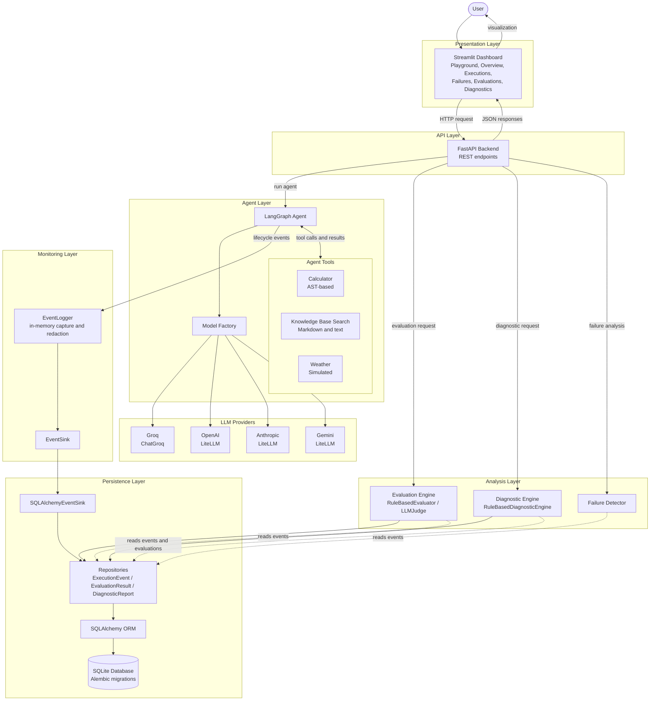
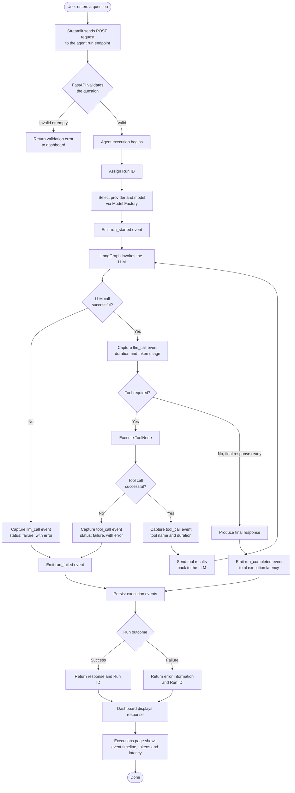
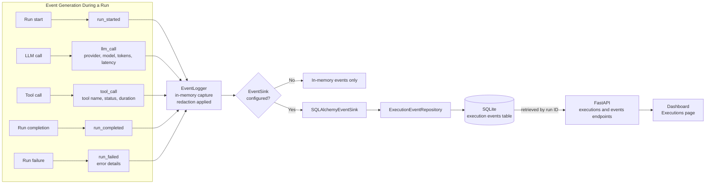
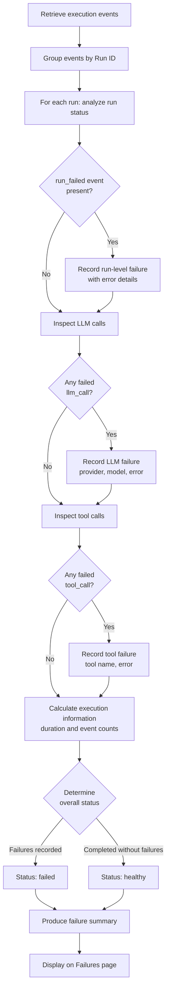
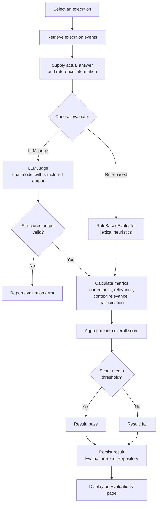
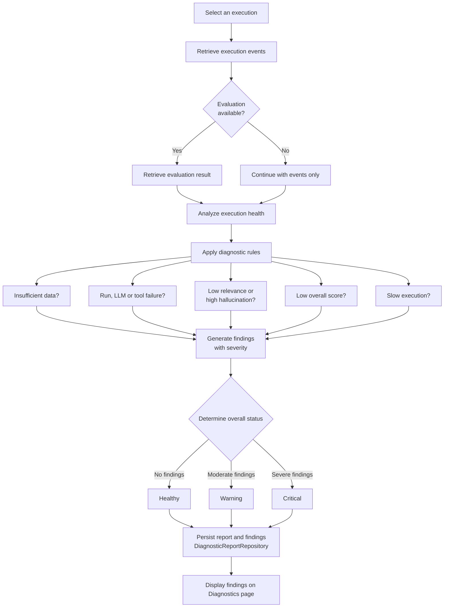
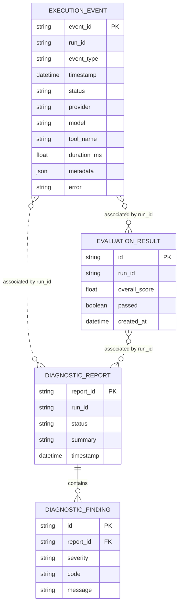
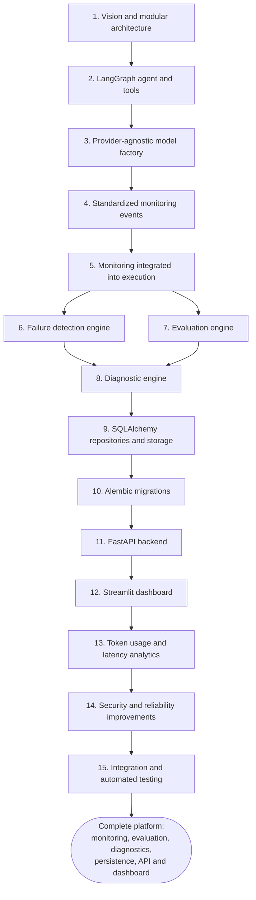

<div align="center">

# AgentSentinel

**Monitor. Evaluate. Diagnose. Improve.**

An AI agent observability and evaluation platform that records what an agent actually did during each run, detects failures, scores response quality, and produces diagnostic reports.


</div>

---

## Table of Contents

1. [Overview](#1-overview)
2. [Key Capabilities](#2-key-capabilities)
3. [System Architecture](#3-system-architecture)
4. [Agent Execution Flow](#4-agent-execution-flow)
5. [Monitoring and Event Lifecycle](#5-monitoring-and-event-lifecycle)
6. [Failure Detection](#6-failure-detection)
7. [Evaluation Engine](#7-evaluation-engine)
8. [Diagnostic Engine](#8-diagnostic-engine)
9. [Persistent Storage](#9-persistent-storage)
10. [FastAPI Backend](#10-fastapi-backend)
11. [Streamlit Dashboard](#11-streamlit-dashboard)
12. [Screenshot Gallery](#12-screenshot-gallery)
13. [Development Journey](#13-development-journey)
14. [Technology Stack](#14-technology-stack)
15. [Getting Started](#15-getting-started)
16. [Design Principles and Limitations](#16-design-principles-and-limitations)
17. [Author](#17-author)

---

## 1. Overview

A typical AI chatbot receives a question and returns an answer. When that answer is wrong, slow, or expensive, there is little visibility into why.

AgentSentinel is a monitoring and quality-assurance layer for AI agents. Instead of observing only the final answer, it captures the full execution lifecycle and uses it to answer questions such as:

| Question | Where AgentSentinel answers it |
|---|---|
| Did the agent run succeed? | Execution status, Failures page |
| Which provider and model were used? | `llm_call` events |
| How many LLM calls were made? | Per-run LLM call table |
| Which tools were executed? | `tool_call` events |
| How long did the run take? | Run and LLM latency |
| How many tokens were consumed? | Provider-reported token usage |
| Did an LLM or tool call fail? | Failure detector |
| Was the response correct and relevant? | Evaluation engine |
| Did the response include unsupported claims? | Hallucination indicators |
| What should be investigated first? | Diagnostic reports |

The goal is to make agent behavior **observable, measurable, and easier to diagnose**.

---

## 2. Key Capabilities

- **LangGraph agent** with a calculator, a local knowledge-base search, and a simulated weather tool.
- **Provider-agnostic model factory** supporting Groq (ChatGroq) and OpenAI, Anthropic, and Gemini (via LiteLLM).
- **Standardized monitoring events**: `run_started`, `llm_call`, `tool_call`, `run_completed`, `run_failed`.
- **Token and latency analytics** based on provider-reported usage, never fabricated.
- **Failure detection** over recorded execution events.
- **Two evaluators**: a rule-based heuristic evaluator and an LLM judge.
- **Rule-based diagnostic engine** producing findings with a Healthy, Warning, or Critical status.
- **Persistence** with SQLAlchemy, SQLite, repository classes, and Alembic migrations.
- **FastAPI REST backend** and a **six-page Streamlit dashboard**.

---

## 3. System Architecture

### Diagram 1: Complete System Architecture



---

## 4. Agent Execution Flow

### Diagram 2: Complete Agent Execution Flow



---

## 5. Monitoring and Event Lifecycle

Monitoring is built into agent execution. Every run produces standardized events that describe what happened, in order.

| Event type | Emitted when | Typical contents |
|---|---|---|
| `run_started` | A run begins | Run ID, timestamp, input information |
| `llm_call` | An LLM invocation finishes | Provider, model, duration, token usage, status, error |
| `tool_call` | A tool finishes executing | Tool name, duration, status, input/output information, error |
| `run_completed` | The run succeeds | Total duration, final status |
| `run_failed` | The run fails | Error details, total duration |

Each event carries an event ID, run ID, timestamp, status, duration, input/output information, error details, and additional metadata. Sensitive values pass through the existing redaction logic before being stored.

### Diagram 3: Monitoring and Event Lifecycle



### Token usage and latency

Token usage is read from the provider-reported `AIMessage.usage_metadata` when it is available.

| Metric | Notes |
|---|---|
| Input / output / total tokens | Reported by the provider |
| Usage availability | Tracked explicitly per LLM call |
| LLM call latency | Duration of each model call |
| Total execution latency | Duration of the complete run |

When a provider does not report usage, the value is treated as **unavailable**, not zero. Estimated cost is shown as unavailable rather than fabricated.

---

## 6. Failure Detection

The `FailureDetector` analyzes recorded execution events and identifies where a run went wrong, rather than showing a generic error.

It examines:

- Overall run status.
- Failed LLM calls.
- Failed tool calls.
- Run-level failures.
- Execution duration.
- Available error information.

### Diagram 5: Failure Detection Workflow



---

## 7. Evaluation Engine

AgentSentinel provides two evaluators with different trade-offs.

| | `RuleBasedEvaluator` | `LLMJudge` |
|---|---|---|
| Approach | Lexical heuristics and keyword-oriented checks | A configured chat model with structured output validation |
| Cost and speed | Fast, no model call | Requires an LLM call |
| Determinism | Deterministic | Depends on the judge model |
| Metrics | Correctness, relevance, context relevance, hallucination indicators, overall score | Structured evaluation validated against a schema |
| Best for | Cheap, repeatable first-pass checks | Judgments that need language understanding |

> **Important:** the rule-based evaluator uses heuristics. It is a practical screening tool, not a semantic or scientifically validated evaluator. Treat its scores as indicators.

Component scores use a 0 to 1 scale. The overall score is shown on a 0 to 100 scale and compared against a pass/fail threshold.

### Diagram 4: Evaluation Workflow



---

## 8. Diagnostic Engine

The `RuleBasedDiagnosticEngine` combines execution events and, when available, evaluation results to produce a diagnostic report. Reports help developers understand potential problems and decide what to investigate first.

| Detectable issue | Source |
|---|---|
| Insufficient execution data | Execution events |
| Failed agent run | Execution events |
| LLM failure | `llm_call` events |
| Tool failure | `tool_call` events |
| Low response relevance | Evaluation result |
| High hallucination score | Evaluation result |
| Low overall evaluation score | Evaluation result |
| Slow execution | Execution duration |

Each report contains a summary, individual findings with a severity, and an overall status: **Healthy**, **Warning**, or **Critical**.

### Diagram 6: Diagnostic Workflow



---

## 9. Persistent Storage

Execution data is preserved in SQLite through SQLAlchemy so it can be retrieved later by the API and dashboard.

| Stored data | Repository |
|---|---|
| Execution events | `ExecutionEventRepository` |
| Evaluation results | `EvaluationResultRepository` |
| Diagnostic reports and findings | `DiagnosticReportRepository` |

- `SQLAlchemyEventSink` connects the monitoring layer to storage, so the agent never touches the database directly.
- Repositories isolate query logic from the API and analysis engines.
- Alembic manages schema migrations.

### Diagram 7: Database ER Diagram

Key columns are shown. Execution events do not belong to a parent run table; evaluations and diagnostic reports are associated with an execution through its run ID. Findings belong to a diagnostic report.



> Column lists are a simplified view for readability. Refer to the SQLAlchemy models for the authoritative schema.

---

## 10. FastAPI Backend

The backend exposes agent execution, history, evaluation, and diagnostics. Interactive OpenAPI documentation is served by FastAPI at `/docs`.

| Method | Route | Purpose |
|---|---|---|
| `GET` | `/health` | Health check |
| `POST` | `/api/v1/agent/run` | Run the agent on a question |
| `GET` | `/api/v1/executions` | List executions |
| `GET` | `/api/v1/executions/{run_id}` | Get one execution |
| `GET` | `/api/v1/executions/{run_id}/events` | List events for an execution |

Evaluation and diagnostic report endpoints are grouped under the `evaluations` and `diagnostics` tags in the generated OpenAPI documentation, covering creation and retrieval.

---

## 11. Streamlit Dashboard

| Page | Purpose |
|---|---|
| **Agent Playground** | Submit a question, run the agent, and read the actual response. Each submission starts a new recorded run. |
| **Overview** | Platform health metrics: total, successful and failed executions, success rate, evaluation count and average score, diagnostic report count, with charts. |
| **Executions** | Run history and per-run details: event timeline, token usage, LLM call latency. |
| **Failures** | Runs that did not complete successfully. |
| **Evaluations** | Response evaluation results and scores. |
| **Diagnostics** | Diagnostic reports, status, and individual findings. |

The Failures page notes that the executions API does not provide status-filtered totals, so failure counts apply to the currently loaded page only.

---

## 12. Screenshot Gallery

> **Placeholders:** the images below are referenced by relative path and will render once the files are added to `docs/screenshots/`.

### Agent Playground


### Overview


### Executions


### Failures


### Evaluations


### Diagnostics


### Token Usage and Latency


---

## 13. Development Journey

AgentSentinel was built in layers, where each phase gave the next one something concrete to build on.

| # | Phase | Builds on |
|---|---|---|
| 1 | Defined project vision and modular architecture | Foundation |
| 2 | Built the LangGraph agent and tools | Architecture |
| 3 | Introduced a provider-agnostic model factory | Agent |
| 4 | Implemented standardized monitoring events | Agent behavior worth observing |
| 5 | Integrated monitoring directly into agent execution | Events and agent |
| 6 | Built the failure detection engine | Recorded events |
| 7 | Developed the evaluation engine | Agent responses and events |
| 8 | Developed the diagnostic engine | Events and evaluations |
| 9 | Added SQLAlchemy repositories and persistent storage | Events, evaluations, diagnostics |
| 10 | Introduced Alembic migrations | Persistent schema |
| 11 | Developed the FastAPI backend | Agent, analysis, storage |
| 12 | Built the Streamlit dashboard | API |
| 13 | Added token usage and latency analytics | Monitoring, API, dashboard |
| 14 | Implemented security and reliability improvements | Whole system |
| 15 | Integrated components and performed automated testing | Whole system |

### Diagram 8: Development Journey



---

## 14. Technology Stack

| Area | Technology |
|---|---|
| Agent orchestration | LangGraph |
| LLM providers | Groq (ChatGroq); OpenAI, Anthropic, Gemini via LiteLLM |
| Backend | FastAPI |
| Dashboard | Streamlit |
| Persistence | SQLAlchemy, SQLite |
| Migrations | Alembic |
| Testing | Automated test suite |

---

## 15. Getting Started

> Adjust commands to match your repository layout and environment.

```bash
# 1. Clone and enter the project
git clone <your-repository-url>
cd AgentSentinel

# 2. Create a virtual environment and install dependencies
python -m venv .venv
source .venv/bin/activate        # Windows: .venv\Scripts\activate
pip install -r requirements.txt

# 3. Configure provider credentials (example)
export GROQ_API_KEY="your-key"

# 4. Apply database migrations
alembic upgrade head

# 5. Start the backend (module path may differ in your project)
uvicorn app.main:app --reload

# 6. Start the dashboard (entry file may differ in your project)
streamlit run dashboard/app.py
```

The Streamlit dashboard runs on `http://localhost:8501` by default, and the backend's interactive API docs are available at `/docs`.

---

## 16. Design Principles and Limitations

<details>
<summary><strong>Engineering principles</strong></summary>

- **Observe the process, not only the answer.** Events describe the whole run.
- **Provider independence.** The monitoring system does not depend on a specific LLM vendor.
- **Honest metrics.** Unavailable token usage is shown as unavailable, and cost is not fabricated.
- **Separation of concerns.** Agent, monitoring, analysis, storage, API, and UI are separate modules.
- **Safe tooling.** The calculator evaluates expressions through an AST-based approach rather than arbitrary code execution.
- **Redaction.** Sensitive information is handled through redaction logic before events are stored.

</details>

<details>
<summary><strong>Known limitations</strong></summary>

- The rule-based evaluator relies on lexical heuristics and is not a semantic or scientifically validated evaluator.
- LLM-judge results depend on the configured judge model.
- The weather tool returns simulated data for selected cities.
- Failure counts on the dashboard apply to the loaded page, because the executions API does not provide status-filtered totals.
- Estimated cost is currently reported as unavailable.
- SQLite suits local and development use; larger deployments would need a different database configuration.

</details>

---

## 17. Author

<div align="center">

### Prithvi Raj Mukhiya

B.Tech, Electronics and Communication Engineering
Indian Institute of Information Technology, Kota (IIIT Kota)

</div>

**Areas of Interest**

- Generative AI
- AI Agents and Agentic AI
- Machine Learning
- Deep Learning
- Data Science
- MLOps

I enjoy building intelligent systems that are not only capable but also observable, measurable, and trustworthy, and I am keen to keep exploring emerging AI technologies and the engineering practices that make them reliable in production.
